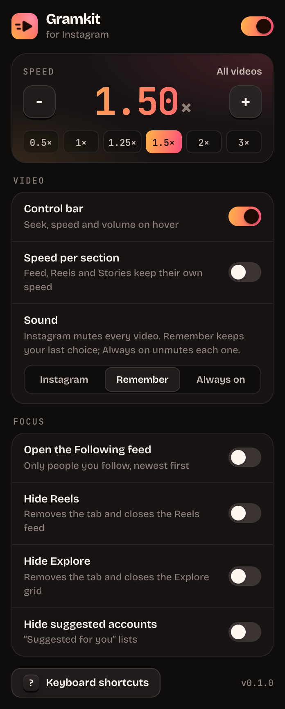
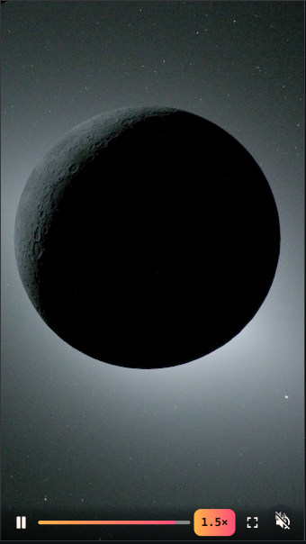

# Gramkit for Instagram

Instagram on the web has no speed control, no seek bar, no volume slider, no downloads and no keyboard shortcuts, and it mutes every video again as you scroll. Gramkit adds all of that, plus focus tools that keep Instagram on the people you follow, or on your messages.

Works in Chrome (and other Chromium browsers) and in Zen and Firefox, from one shared codebase.

<p>
  
  
</p>

## Features

**Video**

- **Speed, 0.25× to 4×.** `>` and `<` step it, `Shift+R` resets, and the popup has presets. It sticks across videos, reloads and tabs. Optionally keep a separate speed for the feed, Reels and Stories.
- **Control bar** on hover: play/pause, time, a draggable seek bar with buffered range and time preview, speed menu (scroll on it to step), volume, picture-in-picture, fullscreen.
- **Sound that stays put.** *Remember* keeps whatever you last chose, including with Instagram's own speaker button. *Always on* unmutes every video. *Instagram* leaves sound alone. Your volume level is kept either way.
- **Autoplay off** for the feed: videos wait until you play them.
- **When a video ends:** loop (Instagram's way), stop on the last frame, or move on to the next reel.
- **Frame by frame** with `,` and `.`, and `Shift+S` saves the current frame as a PNG.

**Downloads**

- `Shift+D`, or the download button on the bar, saves the post, reel or story on screen at the best quality Instagram has: every slide of a carousel, the video of a reel. Files go to `Downloads/Gramkit/`, named `user_code.ext`.
- Stories download one at a time from the story itself (`/stories/user/…`); highlights aren't supported yet.
- It asks Instagram for the post the same way instagram.com does, so it needs you logged in, and gets only what your account can already see.

**Keyboard shortcuts** (YouTube- and Gmail-style, all rebindable, sequences too)

| Key | Action |
|---|---|
| `K` / `Space` | Play / pause |
| `J` / `L` | Back / forward 10 s |
| `←` / `→` | Back / forward 5 s |
| `0`–`9` | Jump to 0–90% |
| `>` / `<` | Faster / slower |
| `Shift+R` | Normal speed |
| `M` | Mute |
| `↑` / `↓` | Volume |
| `F` / `P` | Fullscreen / picture-in-picture |
| `,` / `.` | Previous / next frame |
| `Shift+S` | Save frame as image |
| `Shift+J` / `Shift+K` | Next / previous post |
| `Shift+L` / `Shift+B` | Like / save |
| `Shift+C` / `Shift+U` | Comments / author's profile |
| `[` / `]` | Previous / next photo in a carousel |
| `Shift+D` | Download post, reel or story |
| `G` then `H` `M` `E` `R` `P` `S` | Go to Home, Messages, Explore, Reels, your profile, Saved |
| `/` | Search |
| `Ctrl+K` / `⌘K` | Command palette |
| `?` | Shortcut overlay |

In Stories, `K` and `Space` use Instagram's own pause button, so the story timer stays in step.

**Command palette** (`Ctrl+K` / `⌘K`): every action, page and setting by name, speed presets, profiles you opened lately, `@name` to open a profile, and anything else searches Instagram.

Shortcuts never fire while you type in messages, comments or search. Arrow keys and Space act on a video only while the pointer is over it, so they still scroll the feed and move through posts. On Reels, `↑`/`↓` still move between reels, and in Stories the arrows stay Instagram's.

**Focus**

- Open the **Following** feed (people you follow, newest first) instead of Home.
- Hide **Reels** and **Explore**: the tabs go, and typing their address sends you home. A reel or post opened from the feed, a profile or a message still opens.
- Hide **suggested accounts**.
- **Messages only:** Home, Reels and Explore send you to Messages; profiles, posts and links still open. Turn it on, or set **focus hours** (say 9–18 on weekdays) for it to switch on by itself.
- **Daily time limit** (15 minutes to 2 hours): past it, a full-screen card covers everything but Messages, with *5 more minutes* if you need it. Time counts only while an Instagram tab is in front. The popup shows today's total.

**English and Brazilian Portuguese**, following the browser, or chosen in the settings.

No tracking, no account, no servers. The only network requests are to instagram.com, for downloads you ask for. Settings sync through your browser; Gramkit only runs on instagram.com. It asks for the *downloads* permission to save files into `Downloads/Gramkit/`.

## Install

Build it (below), or take the archives from `dist/`.

### Chrome, Edge, Brave, Arc

1. Unzip `gramkit-chrome-<version>.zip`.
2. Open `chrome://extensions` and turn on **Developer mode**.
3. Click **Load unpacked** and pick the unzipped folder.

### Zen, Firefox

1. Open `about:config` and set `xpinstall.signatures.required` to `false` (Zen, Firefox Developer Edition, Nightly), or sign the build as below.
2. Open `about:addons`, click the gear, choose **Install Add-on From File…** and pick `gramkit-firefox-<version>.xpi`.
3. Allow it on instagram.com when asked.

```sh
npx web-ext sign --source-dir dist/firefox --channel unlisted --api-key "$AMO_JWT_ISSUER" --api-secret "$AMO_JWT_SECRET"
```

## Limits

- Firefox has no picture-in-picture API for extensions; `P` points you to Firefox's own PiP button instead.
- In fullscreen the browser's own controls replace the bar, since nothing can draw over a fullscreen video.
- Instagram changes its web app often. Gramkit avoids its generated class names and relies on routes (`/reels/`, `/explore/people/`), `<video>` elements, media events and the accessible names of Instagram's buttons (*Like*, *Save*, *Next*, in English, Portuguese and Spanish, with a fallback by position), which change far less. Checked against live instagram.com in October 2026.
- Frame stepping assumes 30 fps, which is what nearly all Instagram video uses.
- Saving a frame needs a video Instagram serves from its own page (blob sources are); otherwise you get a note instead.

## How it works

One content script, `src/content/`, runs at `document_start`:

- **`media.ts`** listens for media events (`play`, `ratechange`, `volumechange`…) in the capture phase on the document. Media events don't bubble, but they do pass through capture, so every `<video>` is covered without wiring each one. When Instagram resets the speed or re-mutes a recycled video, the event fires and the setting goes back. A change counts as the user's own when the last click landed on that video (Instagram's speaker button, its slider) or native controls are in use; then it is kept.
- **`videos.ts`** picks the video to act on from the pointer position and each video's on-screen rectangle. Instagram lays transparent overlays over its videos, so hit-testing would find the overlay. A video counts as hovered only if what's on top at the pointer shares a close ancestor with it, which rules out sign-up dialogs, backdrops and menus.
- **`hud.ts`, `controls.ts`** draw the bar, toasts and shortcut overlay in a shadow root attached to `<html>`, outside Instagram's React tree. The bar follows the hovered video's rectangle every frame instead of being inserted into Instagram's markup.
- **`shortcuts.ts`** is one capture-phase `keydown` listener that resolves keys through the keymap in `src/shared/actions.ts`. It only swallows a key when it acted on it.
- **`focus.ts`** toggles attributes on `<html>` that a small stylesheet keys off, watches the URL (Instagram navigates with `pushState` from a JavaScript world content scripts can't hook) and finds "Suggested for you" blocks from their `/explore/people/` link, which works in every language. It also counts time for the daily limit.
- **`posts.ts`** finds the post being looked at (an open post dialog, the one under the pointer, or the most visible), presses Instagram's own buttons on it, and downloads: the shortcode in the post's link decodes to its media id, `/api/v1/media/<id>/info/` returns every version, and the background script saves the widest. Posts opened directly also carry their media in the page's JSON, which is the fallback.
- **`palette.ts`, `nav.ts`** are the command palette and the *go to* targets.
- **`src/shared/i18n.ts`** translates by English text: `t('Volume {n}%')` looks the string up in `i18n-pt.ts` and falls back to English.

Preferences live in `storage.sync`; live playback state (speed, volume) in `storage.local`, so a volume drag doesn't hit sync quotas.

## Develop

```sh
npm install
npm run build        # dist/chrome, dist/firefox and their .zip / .xpi
npm run watch        # rebuild on change
npm run typecheck
npm run lint         # web-ext lint on the Firefox build
npm run icons        # re-render icons from src/static/icons/icon.svg (uses Chrome)
npm start            # Zen with the extension in a temporary profile
npm run start:chrome # Chrome, same
```

`scripts/build.mjs` bundles `src/` with esbuild and writes each browser's manifest; Chrome gets a service worker, Firefox an event page. Everything else is shared.

### Tests

```sh
npm run e2e                     # Chrome: 87 checks
npm run e2e -- --browser=zen    # Zen: the 45 that don't change settings
node test/live.mjs [reel URL]   # smoke check on live instagram.com, logged out
```

`test/e2e.mjs` loads the built extension in a real browser and answers every `www.instagram.com` request with `test/fixture.html`, a page shaped like Instagram: blob video sources, transparent overlays, a speaker button that flips mute, play/pause by visibility, like and save buttons that flip their label, and a carousel. A local server stands in for Instagram's CDN and the media API. It covers speed, sound, seeking, frames, shortcuts and sequences, posts, the palette, downloads (post, carousel, story, frame), typing safety, the bar, rebinding, the focus switches, Messages only, focus hours, the time limit, Portuguese, the master switch, the popup and the options page. Screenshots go to `dist/screenshots/`.
